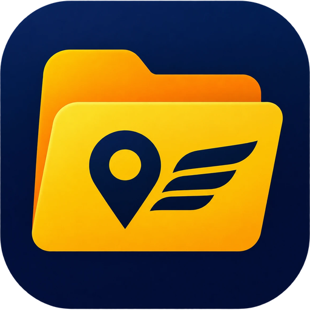
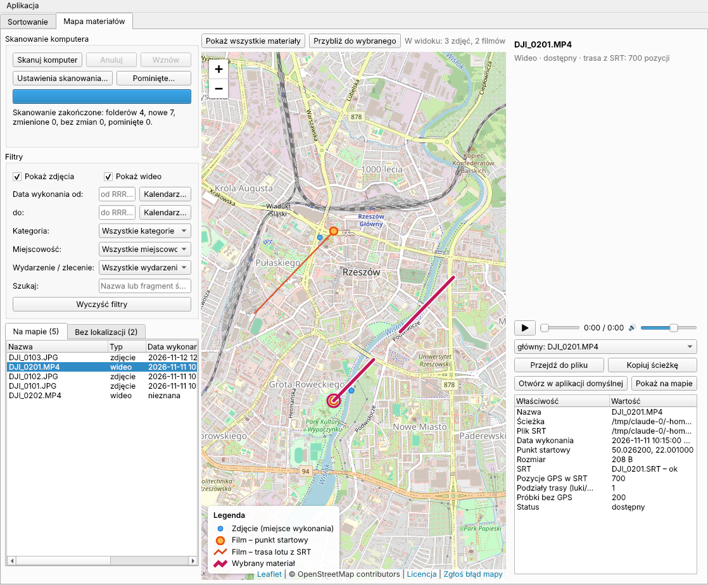

# SkyCatalog

Desktopowa aplikacja dla Windows do archiwizacji materiałów z lotów (dron, kamera). Ma dwie zakładki:

* **Sortowanie** – wczytujesz kartę pamięci, **ręcznie** przypisujesz kategorię (Hobby, Eventy,
  Zlecenia), a aplikacja przenosi filmy i zdjęcia do uporządkowanej struktury folderów,
* **Mapa materiałów** – przeszukuje komputer w poszukiwaniu zdjęć i filmów z GPS i pokazuje je
  na mapie OpenStreetMap: zdjęcia jako punkty, filmy jako punkt startowy i trasa lotu z całego SRT.



## Pobierz (wersja przenośna)

1. Otwórz [**najnowsze wydanie**](https://github.com/Fotolot/SkyCatalog/releases/latest)
   i pobierz **`SkyCatalog-portable.zip`**.
2. Rozpakuj ZIP w dowolne miejsce z prawem zapisu (np. `Dokumenty` albo `D:\Programy`) – powstanie
   folder `SkyCatalog`. Uruchom `SkyCatalog\SkyCatalog.exe`. Nie trzeba instalatora ani Pythona;
   cały folder trzymaj razem (zawiera bibliotekę Qt i przeglądarkę mapy).

Windows SmartScreen może ostrzec przed nieznanym, niepodpisanym programem: „Więcej informacji” →
„Uruchom mimo to”. Folder z kartą możesz przeciągnąć na `SkyCatalog.exe` – zostanie od razu wczytany.

## Wersje i aktualizacje

* **Numer wersji**: MAJOR.MINOR z pliku [`VERSION`](VERSION) + numer budowania GitHub Actions,
  np. `1.1.15`. Widać go w **Aplikacja → O programie…** i we właściwościach pliku `.exe`
  (Szczegóły). Zmianę MAJOR.MINOR robi się, edytując plik `VERSION`.
* **Wydania**: każdy push do `main` (lub ręczne uruchomienie workflow na `main`) buduje program,
  uruchamia testy i samotest, pakuje cały folder do `SkyCatalog-portable.zip` i tworzy tag
  `v<wersja>` oraz [GitHub Release](https://github.com/Fotolot/SkyCatalog/releases) z listą
  zmian. Push na inne gałęzie tylko buduje i testuje (plik do pobrania w zakładce Actions).
* **Aktualizacja w programie**: kilka sekund po starcie program w tle sprawdza najnowsze wydanie.
  Brak internetu lub błąd serwera niczego nie blokuje. Gdy jest nowsza wersja, pojawia się okno
  „Dostępna wersja X.Y.Z” z listą zmian:
  * **Aktualizuj** – pobiera ZIP do folderu tymczasowego, rozpakowuje go, uruchamia skrypt
    pomocniczy i zamyka program. Skrypt czeka na zamknięcie, robi **kopię zapasową** bieżącej
    wersji w podfolderze `_backup`, kopiuje nowe pliki do folderu programu i uruchamia go ponownie.
    Jeśli kopiowanie się nie uda – przywraca kopię i uruchamia poprzednią wersję z komunikatem
    (log: `aktualizacja.log` w folderze tymczasowym `%TEMP%\SkyCatalog-aktualizacja-<wersja>`).
  * **Później** – zamyka okno; można sprawdzić ponownie w **O programie → Sprawdź aktualizacje**.
* **Dane użytkownika nie są zmieniane przez aktualizację.** Program trzyma je poza folderem `.exe`:
  * `%APPDATA%\SkyCatalog\` – `ustawienia.json`, `decyzje_lokalizacji.json`,
    `historia_sortowania.json`, `cache_osm.json`,
  * `%LOCALAPPDATA%\SkyCatalog\` – `katalog.sqlite` (+ `-wal`, `-shm`), `miniatury\`,
    `przegladarka\` (cache mapy).

  Dodatkowo skrypt nigdy nie kopiuje, nie nadpisuje ani nie usuwa w folderze programu:
  `ustawienia.json`, `cache_osm.json`, `decyzje_lokalizacji.json`, `historia_sortowania.json`,
  `*.sqlite`, `*.sqlite-wal`, `*.sqlite-shm`, `*.db`, `*.log`, `*.tmp` ani folderów `_backup`,
  `miniatury`, `przegladarka`, `kafelki`, `logs`, `dane`, `data`.
* Folder programu musi mieć prawo zapisu (nie `Program Files`) – inaczej program poprosi o ręczne
  pobranie nowej wersji.

## Kategorie lotów

Kategorię zawsze wybiera użytkownik – aplikacja jej nie zgaduje. Pola wyboru wyglądają
jak checkboxy, ale dla danej grupy materiałów można zaznaczyć tylko jedną kategorię.
Kategorię można przypisać **wszystkim materiałom z importu** albo **zaznaczonym grupom**
(Ctrl/Shift + klik na liście), np. część karty to Event, a reszta to luźne loty.

| Kategoria | Struktura | Dane |
|---|---|---|
| **Hobby / Luźne loty** | `Hobby/[Miejscowość]/Zdjęcia` i `…/WIDEO`, opcjonalnie `Hobby/[Miejscowość]/[Nazwa miejsca]/…` | miejscowość rozpoznawana z GPS każdego materiału; nazwę miejsca (opcjonalną) wpisuje użytkownik |
| **Eventy** | `Eventy/[Miejscowość]/[RRRR-MM-DD] [Nazwa]/WIDEO` i `…/Zdjęcia` | nazwa i data wydarzenia (wymagane), miejscowość z GPS do poprawienia |
| **Zlecenia** | `Zlecenia/[Lokalizacja]/[RRRR-MM-DD] [Nazwa]/WIDEO` i `…/Zdjęcia` | lokalizacja, data realizacji, nazwa/opis (wymagane, wpisuje użytkownik) |

Przykłady:

```
Hobby/Rzeszów/Zdjęcia/                                   ← bez nazwy miejsca
Hobby/Rzeszów/WIDEO/
Hobby/Rzeszów/Pomnik/Zdjęcia/                            ← po wpisaniu nazwy „Pomnik”
Hobby/Rzeszów/Pomnik/WIDEO/
Eventy/Rzeszów/2026-11-11 Bieg Niepodległości/WIDEO/
Zlecenia/Łańcut/2026-11-25 Film promocyjny nieruchomości/Zdjęcia/
```

Zasady:

- **Hobby** – miejscowość jest rozpoznawana z GPS każdego materiału, więc materiały z różnych
  miejscowości trafiają do różnych folderów. Gdy punkt leży w kilku miejscowościach, wybierasz
  właściwą z listy; gdy brak GPS lub internetu – wpisujesz miejscowość ręcznie.
  Pole **„Nazwa miejsca / obiektu”** jest opcjonalne (np. *Pomnik Czynu Rewolucyjnego*).
  Puste – materiały trafiają bezpośrednio do folderu miejscowości. Nazwa dotyczy całej zaznaczonej
  grupy materiałów (całego przypisania), a nie pojedynczych plików. Aby nadać różne nazwy, zaznacz
  część grup na liście i kliknij **„Wydziel jako osobne”** (albo zaznacz grupy i wybierz dla nich
  Hobby osobno), po czym wpisz nazwę dla każdej części.
  Program **nie wyszukuje** pobliskich obiektów i nie zgaduje, co zostało sfotografowane.
- **Eventy** i **Zlecenia** – wszystkie przypisane materiały trafiają do jednego folderu
  wydarzenia/zlecenia; bez podfolderów nazw miejsc i bez dzielenia według GPS.
- **Data** jest proponowana na podstawie daty wykonania materiałów (EXIF, SRT, nazwa
  pliku DJI, metadane MP4) – zawsze można ją zmienić. Data modyfikacji pliku **nie** jest
  używana jako data nagrania.
- **Kolejne karty** – w Eventach i Zleceniach lista „Dołącz do istniejącego” pokazuje
  foldery już zapisane w archiwum, więc materiały z kilku kart trafiają do tego samego folderu.
- **Powiązane pliki** – film, jego `.SRT`, `.LRF` i inne pliki o tej samej nazwie tworzą
  jedną grupę i zawsze otrzymują tę samą kategorię i to samo miejsce docelowe.
- **Plik o tej samej nazwie w archiwum** – zanim cokolwiek zostanie skopiowane lub przeniesione,
  program pokazuje okno **„Pliki o takich samych nazwach”** (rozmiar i data obu plików, z dopiskiem,
  gdy wyglądają na ten sam plik) i pyta o każdą grupę:
  - **Zmień nazwę nowego pliku (zachowaj oba)** – domyślnie; cała grupa dostaje ten sam dopisek,
    np. `DJI_0001 (1).MP4` + `DJI_0001 (1).SRT`,
  - **Nadpisz plik w archiwum** – nowy plik zajmuje miejsce starego; poprzednia wersja **nie jest
    kasowana**, tylko przenoszona do folderu `.SkyCatalog-zastapione\<data_czas>\…` w archiwum.
    „Cofnij ostatni import” przywraca ją na miejsce; folder można usunąć ręcznie, gdy nie jest potrzebny,
  - **Pomiń (nie importuj)** – ta grupa nie jest kopiowana/przenoszona.

  Przyciski „Zmień nazwę wszystkim / Nadpisz wszystkie / Pomiń wszystkie” ustawiają decyzję dla
  całej listy, „Anuluj” nic nie zmienia. Podgląd struktury folderów wcześniej informuje, ile nazw
  jest zajętych. Gdy dwa materiały z tego samego importu mają tę samą nazwę (np. dwie karty),
  drugi zawsze dostaje dopisek `(1)` – bez pytania.
- **Podgląd na żywo** – docelowa struktura folderów aktualizuje się podczas wypełniania
  formularza. Przycisk „Przenieś materiały” jest nieaktywny, dopóki każda grupa nie ma
  kategorii, a wymagane pola nie są uzupełnione.
- **Bezpieczeństwo** – istniejące pliki są zastępowane wyłącznie po wybraniu „Nadpisz”, a ich
  poprzednie wersje trafiają do kopii zapasowej; ostatni import można cofnąć przyciskiem
  „Cofnij ostatni import”.

## Układ okna

* Wszystkie panele można poszerzać i zwężać, przeciągając uchwyty między nimi (podświetlają się
  po najechaniu myszą) – w poziomie i w pionie: lista materiałów, kategoria, formularz, podgląd
  struktury; skanowanie, filtry, listy, mapa i panel podglądu; obraz/film i szczegóły.
* W wąskim oknie (np. na 1/3 ekranu) panele, które się nie mieszczą, mają paski przewijania,
  przyciski przechodzą do kolejnego wiersza, a opisy pól w formularzach – nad pola.
* Układ i rozmiar okna są zapamiętywane po zamknięciu programu.
  **Widok → Przywróć domyślny układ paneli** przywraca ustawienia początkowe.

## Import z karty SD

* Po włożeniu karty pamięci (dysk wymienny z folderem `DCIM`) nad zakładką sortowania pojawia się
  pasek „Wykryto kartę pamięci…”. **Importuj z karty** wczytuje materiały z karty w trybie kopiowania.
* Lista pokazuje tylko **nowe** materiały – pliki skopiowane wcześniej (lub już obecne w archiwum
  pod tą samą nazwą, z tym samym rozmiarem i czasem zapisu) są ukryte. Pole **Pokaż także materiały
  już zaimportowane** pokazuje je z dopiskiem „(już w archiwum)”.
* Po wybraniu kategorii i uzupełnieniu formularza **Kopiuj do archiwum** kopiuje pliki: najpierw do
  pliku tymczasowego, potem po sprawdzeniu rozmiaru pod docelową nazwę (z zachowaniem daty). Przerwana
  kopia nie zostawia uszkodzonych plików, istniejący plik o tej samej nazwie jest zastępowany tylko
  po wybraniu „Nadpisz” (poprzednia wersja trafia do kopii zapasowej), a na karcie
  nic nie jest zmieniane ani usuwane – po zakończeniu kartę można bezpiecznie wysunąć.
* **Cofnij ostatni import** po kopiowaniu usuwa wyłącznie utworzone kopie (oryginały zostają),
  a nadpisane pliki przywraca z kopii zapasowej.
* Tryb **Przenieś / Kopiuj** można też wybrać ręcznie dla dowolnego folderu importu; wybór jest zapamiętywany.

## Mapa materiałów

### Skanowanie komputera

* **Skanuj komputer** przeszukuje domyślnie wszystkie lokalne dyski i partycje (także wymienne,
  np. karty) razem z podfolderami. Skanowanie działa w tle – postęp, liczba znalezionych materiałów
  i aktualny folder są widoczne na bieżąco. **Anuluj** przerywa, **Wznów** kontynuuje od miejsca
  przerwania (także po ponownym uruchomieniu programu).
* **Ustawienia skanowania…** – wybór dysków lub folderów, opcjonalne dyski sieciowe i wykluczenia.
* Nie są potrzebne uprawnienia administratora. Foldery bez dostępu, foldery systemowe i ukryte
  (Windows, Program Files, AppData, kosz itp.) są pomijane – przycisk **Pominięte…** pokazuje podsumowanie.
* Nie wchodzi w dowiązania i punkty połączeń (bez ryzyka pętli). Pliki dostępne **tylko w chmurze**
  (OneDrive itp.) są zapisywane w katalogu, ale nie są pobierane. Odłączony dysk: wpisy pozostają
  i są oznaczone jako niedostępne.
* Kolejne skanowania analizują tylko nowe i zmienione pliki (rozmiar i czas – także samego SRT),
  bez liczenia sum kontrolnych. Pliki usunięte lub przeniesione poza aplikacją są wykrywane.
* Nic nie jest wysyłane do internetu – zdjęcia, filmy i SRT są czytane wyłącznie lokalnie.

### Co jest pokazywane

* **Zdjęcia** JPG/JPEG/DNG – mała kropka w miejscu zapisanym w EXIF (prawidłowe N/S i E/W).
  Para JPG + DNG o tej samej nazwie w tym samym folderze to jeden materiał; w panelu można wybrać
  każdy z plików. Zdjęcia bez GPS trafiają na listę **Bez lokalizacji** (bez fikcyjnego punktu).
* **Filmy** MP4/MOV z SRT (ta sama nazwa i folder) – wyraźny punkt startowy (pierwsza prawidłowa
  pozycja na osi czasu) i linia trasy z **całego** SRT. Luki i oczywiste skoki GPS dzielą linię na
  segmenty zamiast rysować fałszywe połączenia; oryginalne próbki są zachowane w katalogu.
  Pozycja drona jest odróżniana od punktu startowego/pilota (`HOME`). Obsługiwane warianty SRT DJI:
  Mini 3/4 Pro, Air/Mavic, starsze `GPS()/HOME()`, gogle i Avata 2.
* Film bez SRT lub bez prawidłowej trasy jest oznaczony na liście jako **wymagający danych** –
  trasa nigdy nie jest zgadywana. Każdy plik nagrania dzielonego ma własną trasę.
* Zakładka sortowania nadal ustala lokalizację z **pierwszych 3 sekund** SRT – to osobne użycie parsera.

### Obsługa mapy

* Przesuwanie i przybliżanie myszą, **Pokaż wszystkie materiały**, **Przybliż do wybranego**, legenda.
* Kliknięcie punktu lub linii pokazuje materiał w prawym panelu. Gdy w miejscu kliknięcia jest kilka
  materiałów, pojawia się lista do wyboru. Wszystkie trasy w widoku są widoczne od razu.
* Filtry działają łącznie na mapę i listy: **Pokaż zdjęcia** / **Pokaż wideo** (osobne warstwy),
  zakres dat wykonania, kategoria (Hobby, Eventy, Zlecenia, Nieprzypisane), miejscowość, wydarzenie
  lub zlecenie, wyszukiwanie po nazwie i ścieżce, **Wyczyść filtry**. Data modyfikacji pliku nigdy
  nie jest traktowana jako data wykonania.
* Motyw jasny/ciemny/systemowy: menu **Aplikacja → Ustawienia…**.

### Panel podglądu

* Zdjęcie z poprawną orientacją (EXIF), nazwa, ścieżka, data, GPS, rozmiar, rozdzielczość i dane aparatu.
  DNG jest pokazywany przez wbudowany w plik podgląd JPEG.
* Film: odtwarzacz (odtwarzanie, pauza, przewijanie, głośność), punkt startowy, czas trwania,
  rozdzielczość, FPS, dane sprzętu i status powiązanego SRT.
* **Przejdź do pliku** (Eksplorator z zaznaczonym plikiem), **Otwórz w aplikacji domyślnej**, **Kopiuj ścieżkę**.
* Brak kodeka lub podglądu nie powoduje awarii – pojawia się komunikat i możliwość otwarcia pliku
  w aplikacji domyślnej. Aplikacja nie instaluje kodeków i nie konwertuje plików.
  Filmy H.265/HEVC z dronów DJI mogą wymagać „Rozszerzeń wideo HEVC” z Microsoft Store.

### Powiązanie z sortowaniem

Obie zakładki korzystają z tego samego katalogu materiałów. Po przeniesieniu w zakładce sortowania
aktualizowane są ścieżki filmu, zdjęcia i plików towarzyszących (SRT, DNG, LRF), kategoria,
miejscowość oraz wydarzenie/zlecenie – trasa i metadane zostają, a mapa odświeża się bez skanowania
dysków. Częściowy błąd i cofnięcie operacji są uwzględniane. Kategoria nigdy nie jest przypisywana
na podstawie położenia pliku na dysku.

### Mapa bazowa i zasady dostawcy

* Mapa to [Leaflet](https://leafletjs.com/) 1.9.4 dołączony do aplikacji (`sortowanie/web/leaflet`,
  licencja BSD-2), wyświetlany w QtWebEngine. Punkty i trasy są rysowane na Canvas; geometria
  jest pobierana z lokalnego katalogu tylko dla bieżącego widoku, a przy bardzo gęstych zbiorach
  punkty są przerzedzane (kliknięcie i tak pokazuje wszystkie materiały w danym miejscu).
* Domyślny podkład: `https://tile.openstreetmap.org/{z}/{x}/{y}.png` zgodnie z
  [zasadami OSMF](https://operations.osmfoundation.org/policies/tiles/): pobierane są wyłącznie
  kafelki oglądanego widoku, z cache HTTP na dysku i własnym User-Agent aplikacji; **nie ma**
  pobierania obszarów ani trybu offline. Oznaczenie „© OpenStreetMap contributors” i odnośnik
  „Zgłoś błąd mapy” są stale widoczne na mapie.
* Dostawcę podkładu (adres, oznaczenie źródła, maks. przybliżenie) zmienisz w **Ustawieniach** –
  przed zmianą sprawdź warunki wybranego dostawcy.
* Overpass API **nie** służy do rysowania mapy – tylko do rozpoznawania miejscowości
  w zakładce sortowania.
* Bez internetu: lista materiałów, filtry, metadane i podgląd działają normalnie, a mapa pokazuje
  czytelny komunikat o niedostępnym podkładzie.

### Bezpieczeństwo

* Zakładka mapy tylko odczytuje pliki – nie zmienia metadanych, nazw ani położenia.
* Nazwy plików, ścieżki i metadane są traktowane jako niezaufane: nie trafiają do HTML/JavaScript
  (lista wyboru i panel są w Qt i pokazują zwykły tekst).
* Strona mapy jest serwowana przez wewnętrzny schemat `fotolot://` wyłącznie z białej listy plików
  aplikacji – bez lokalnego serwera HTTP i bez dostępu do dysku. Nawigacja i nowe okna są zablokowane.
* Eksplorator i aplikacja domyślna są otwierane przez API Windows, bez budowania poleceń powłoki.
  Akcje są dostępne tylko dla plików zapisanych w katalogu.

## Lokalizacja: OpenStreetMap przez Overpass API

Miejscowości są rozpoznawane wyłącznie na podstawie danych
[OpenStreetMap](https://www.openstreetmap.org/) pobieranych przez
[Overpass API](https://wiki.openstreetmap.org/wiki/Overpass_API) – bez płatnych usług.
Do serwera wysyłane są **wyłącznie współrzędne** – nigdy zdjęcia, filmy ani nazwy plików.
Aplikacja nie wysyła zapytań o pobliskie obiekty.

**Miejscowość** – zapytanie `is_in` zwraca obszary OSM obejmujące punkt; aplikacja analizuje
ich tagi:

- obszar z `place=city|town|village|hamlet` → miejscowość,
- granica administracyjna bez `place` → miejscowość tylko, gdy potwierdza ją węzeł `place`
  o tej samej nazwie lub `border_type`,
- gminy, powiaty i województwa nie są traktowane jako miejscowość,
- dzielnice i osiedla (`place=suburb|quarter|neighbourhood`, `admin_level` ≥ 9) nie tworzą folderów,
- kilka różnych miejscowości lub brak obszaru → **użytkownik wybiera** z listy propozycji.

**Oszczędne zapytania** – zgodnie z [zasadami publicznej instancji](https://dev.overpass-api.de/overpass-doc/en/preface/commons.html)
(orientacyjnie do 10 000 zapytań i 1 GB dziennie):

- zapytania wykonywane są w tle, pojedynczo, z kolejką i odstępem,
- wielokąty miejscowości są zapisywane – kolejne materiały w ich granicach nie wymagają zapytania,
- wynik dla punktu jest ponownie używany dla bliskich materiałów (do 150 m),
- zapytania deklarują małe `[timeout]` i `[maxsize]`,
- HTTP 429: oczekiwanie na wolny slot według `/api/status`, potem ponowienie,
- HTTP 504 (i 502/503): ponowienie po 15, 30, 60, 120 s.

**Własny serwer** – endpoint (domyślnie `https://overpass-api.de/api/interpreter`) zmienisz
bez zmiany kodu: w oknie **Ustawienia…** albo zmienną środowiskową:

```bat
set SORTOWANIE_OVERPASS_URL=https://moj-serwer.example/api/interpreter
py main.py
```

**Cache i decyzje** (w `%APPDATA%\SkyCatalog\`):

- `cache_osm.json` – pobrane dane OSM (odświeżane po 180 dniach, gdy jest internet),
- `decyzje_lokalizacji.json` – wybory miejscowości, podpowiadane przy kolejnych importach
  z tego miejsca (wpisy o obiektach ze starszych wersji zostają w pliku, ale nie są używane),
- `ustawienia.json`, `historia_sortowania.json`.

Bez internetu aplikacja korzysta z zapisanych danych i decyzji, a gdy ich brak – pozwala
wpisać miejscowość ręcznie.

**Źródło danych:** © [OpenStreetMap contributors](https://www.openstreetmap.org/copyright),
licencja ODbL. Oznaczenie jest widoczne w oknie aplikacji i w ustawieniach.

### Diagnostyka na prawdziwych danych

```bat
py narzedzia\sprawdz_lokalizacje.py 50.027082,22.003366 50.040451,21.999130
```

Skrypt wypisuje wysłane zapytania, skrót odpowiedzi serwera, klasyfikację obszarów,
rozpoznaną miejscowość i proponowane foldery Hobby (bez nazwy miejsca i z nazwą z opcji `--nazwa`).
Opcja `--surowe` pokazuje pełny JSON, `--endpoint` pozwala sprawdzić własny serwer.

## Obsługiwane pliki

- Wideo: MP4, MOV, AVI, MKV, M4V, MTS, INSV…
- Zdjęcia: JPG, DNG, HEIC, PNG, TIFF, RAW (ARW, CR2, CR3, NEF)…
- Pliki towarzyszące: SRT, LRF, LRV, THM, XMP, AAE…

GPS jest odczytywany z napisów SRT dronów DJI, z EXIF zdjęć oraz z metadanych MP4.

## Wymagania i zależności

* Windows 10 lub 11.
* Gotowy program (folder `SkyCatalog`) zawiera wszystko – Python nie jest potrzebny.
* Uruchomienie ze źródeł: [Python 3.10+](https://www.python.org/downloads/windows/) oraz
  `requirements.txt`:
  * **PySide6** (Qt 6) – interfejs, QtWebEngine (mapa Leaflet), QtMultimedia (odtwarzacz).
* Do budowania: `requirements-dev.txt` (PyInstaller). Leaflet jest w repozytorium – nie trzeba
  niczego pobierać z CDN.

## Uruchomienie ze źródeł

```bat
git clone https://github.com/Fotolot/SkyCatalog.git
cd SkyCatalog
py -m pip install -r requirements.txt
py main.py
```

Opcje: `py main.py <folder_karty>` (od razu wczytuje import), `--mapa` (otwiera zakładkę mapy),
`--skanuj` (od razu rozpoczyna skanowanie). Przykładowe dane do wypróbowania:
`py narzedzia\dane_demo.py C:\Temp\demo`.

### Jak używać

**Sortowanie:** wybierz kartę i kliknij „Wczytaj”, wybierz folder archiwum, zaznacz kategorię
i uzupełnij pola formularza (podgląd struktury aktualizuje się na żywo), kliknij „Przenieś materiały”.

**Mapa materiałów:** kliknij „Skanuj komputer” (lub najpierw „Ustawienia skanowania…”), potem
filtruj, klikaj punkty i trasy, a szczegóły oglądaj w prawym panelu.

## Budowanie programu

```bat
build.bat
```

Ikona programu: `assets/SkyCatalog.ico` (plik `.exe`) i `sortowanie/assets/ikona.png` (okno).

Skrypt tworzy `.venv`, instaluje zależności, uruchamia testy i buduje folder
**`dist\SkyCatalog\`** z plikiem `SkyCatalog.exe`. Aplikacja jest budowana jako folder (nie jeden
plik), bo QtWebEngine ma ok. 200 MB i w trybie jednego pliku byłby rozpakowywany przy każdym starcie.
Nieużywane części Qt (moduły QML i Quick 3D, kontrolki Quick, wykresy, PDF, narzędzia deweloperskie
przeglądarki, tłumaczenia innych języków niż polski i angielski) są pomijane – folder jest o ok. 30% mniejszy.

Ręcznie:

```bat
py -m venv .venv
.venv\Scripts\activate
pip install -r requirements-dev.txt
pyinstaller --clean --noconfirm sortowanie.spec
```

## Testy

```bat
py -m unittest discover -s tests -t .
```

Testy obejmują m.in. parser SRT (formaty DJI, luki, skoki, okno 3 s), katalog i skaner (pary JPG/DNG,
brak/uszkodzony SRT, przyrostowe skanowanie, anulowanie i wznowienie, brak uprawnień, dowiązania,
odłączony dysk, przeniesienie i cofnięcie, wydajność na 60 tys. materiałów), filtry, białą listę
zasobów mapy oraz – tylko na Windows – punkty połączeń, ukryte foldery i listę dysków.

## Struktura projektu

```
Sortowanie/
├── main.py               # punkt startowy (również dla PyInstaller)
├── sortowanie/
│   ├── ui/               # interfejs PySide6: app, sort_tab, map_tab, preview_panel, webmap, dialogs
│   ├── web/              # strona mapy (map.html/js/css) i Leaflet 1.9.4 (lokalnie)
│   ├── catalog.py        # lokalny katalog materiałów (SQLite)
│   ├── scanner.py        # skanowanie dysków w tle
│   ├── srt.py            # parser SRT: pełna trasa (mapa) i 3 s (sortowanie)
│   ├── preview.py        # podgląd DNG, Eksplorator, aplikacja domyślna
│   ├── tiles.py          # konfiguracja dostawcy podkładu mapy
│   ├── planner.py        # kategorie, walidacja, struktura folderów
│   ├── media.py          # wczytywanie importu i grupowanie powiązanych plików
│   ├── metadata.py       # odczyt GPS i daty (EXIF, SRT, MP4)
│   ├── geo.py            # miejscowość z GPS, cache danych i wyborów
│   ├── osm.py            # analiza danych OSM: geometria, klasyfikacja, zapytania
│   ├── overpass.py       # klient Overpass API (kolejka, 429/504, endpoint)
│   ├── config.py         # ustawienia w %APPDATA%\SkyCatalog
│   └── core.py           # przenoszenie plików, historia, cofanie
├── narzedzia/           # sprawdz_lokalizacje.py – diagnostyka na prawdziwych danych
├── tests/                # testy jednostkowe (unittest)
├── sortowanie.spec       # konfiguracja budowania .exe
├── build.bat             # skrypt budujący .exe
├── requirements-dev.txt  # zależności do budowania
└── .env.example          # wzór pliku konfiguracyjnego (bez sekretów)
```

## Prywatność repozytorium

Plik `.gitignore` wyklucza z repozytorium:

- klucze API i sekrety (`.env`, `*.key`, `*.pem`, `secrets.*`, `credentials*.json`, …),
- prywatne materiały i dane robocze (`prywatne/`, `private/`, `dane/`, `data/`, `wyniki/`, `output/`, `logs/`),
- lokalne dane aplikacji (`ustawienia.json`, `cache_osm.json`, `decyzje_lokalizacji.json`, `historia_sortowania.json`),
- lokalny indeks materiałów, miniatury i cache mapy (`*.sqlite`, `miniatury/`, `kafelki/`).

Dane programu na komputerze: `%APPDATA%\SkyCatalog\` (ustawienia, decyzje, historia, cache OSM)
oraz `%LOCALAPPDATA%\SkyCatalog\` (`katalog.sqlite`, `miniatury\`, `przegladarka\` – cache kafelków).
- cache Pythona i narzędzi (`__pycache__/`, `.pytest_cache/`, …),
- środowiska wirtualne (`.venv/`),
- pliki wynikowe budowania (`build/`, `dist/`, `*.exe`).
